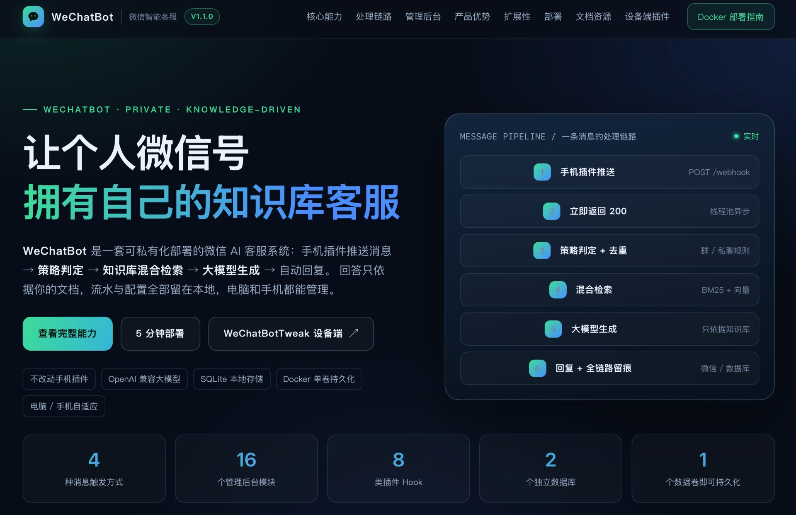

# WeChatBot · 个人微信智能客服系统

一套可私有化部署的微信 AI 客服系统。手机端消息经 HTTP 推送 → 策略判定 → 知识库混合检索 →
大模型生成 → 自动回复。回答只依据你的文档，配置、流水与日志全部留在本地，电脑和手机都能管理。

- **官网**：<https://wxbottweak.kdns.fr>
- **Docker 镜像**：`gavintom/wechatbot`
- **当前源码版本**：**V1.1.2-beta5**（开发中，基于 V1.1.1 正式版；Docker Hub 稳定版仍为 `1.1.0`）
- **许可证**：MIT · [](LICENSE)



> **V1.1.2-beta5 更新要点**：**每条群聊 / 私聊配置各自选一个大模型**（规则级）。
> 「群聊配置」「私聊配置」的新建 / 编辑弹窗里新增「大模型」下拉（`llm_id`）：
> 选定后，命中这条配置的消息一律用该模型应答；选「不指定」则跟随默认模型。
> 生效顺序：**本条配置指定的模型 → 分场景兜底（群聊/私聊整体）→ 全局默认 → config.yaml**。
> 之前 beta2 只做了「群聊整体一个、私聊整体一个」，颗粒度太粗；那两个页顶部的整体卡片已移除，
> 只保留「AI 大模型」页的分场景兜底（明确标注为兜底）。
> 选的模型被停用或删除时**自动回退默认模型**（不会让该群哑掉），列表里标「已停用 / 模型已删除」。
> 两个列表都新增「大模型」列，一眼看清每条配置用的是哪个模型；运行日志会记
> 「AI 应答 | 场景=… | 配置=… | 模型=… | 纳管id=… | 来源=override(本条配置) | …」，
> 用量流水同样落 `llm_id`。

> **V1.1.2-beta4 更新要点**：修复「AI 大模型」页**点「导出配置」没反应**。
> beta3 里模型页的导出按钮与「AI 用量」页的「导出 CSV」用了同一个元素 id
> （`btnLlmExport`），前端按下标取元素只拿到第一个，模型页那个按钮实际没有绑定事件；
> 现改为独立的 `btnLlmModelsExport`，并在验证脚本里加了「模板内无重复 id」的断言防复发。

> **V1.1.2-beta3 更新要点**：**大模型配置可导出 / 导入**（换机器、多套部署之间搬配置、改前留备份）。
> 「AI 大模型」页模型列表右上角新增「导出配置」「导入配置」：导出为一份 JSON，
> 含全部纳管模型、默认模型与群聊/私聊场景选择。默认、场景这类引用**用模型名称表达**，
> 所以导到另一台机器上会自动映射到那边的模型 id，不会指错。
> 导入有两种方式：**合并**（同名覆盖，文件里没有的模型保留）与**全量替换**
> （同名更新后删除文件里没有的模型）。导入前整体校验，任一条不合法就整批拒绝、库内不变。
> 导出**默认带明文 API Key**（否则导过去不能用），因此导出文件等同密钥载体，
> 页面会先提示妥善保管；接口加 `?secrets=0` 可导出脱敏版，脱敏版导入时沿用目标机已有密钥。

> **V1.1.2-beta2 更新要点**：**群聊 / 私聊各自选择大模型**。
> 「AI 大模型」页新增「分场景模型」卡片：群聊应答、私聊应答各选一个纳管模型，
> 留「跟随全局默认」则沿用默认模型。生效优先级为
> **本次显式指定 > 场景模型 > 全局默认模型 > config.yaml**，保存后下一条消息即生效、无需重启。
> 场景模型被停用或删除时自动回退到全局默认（不会让群聊/私聊整条哑掉），删除模型时一并清理指向它的场景配置。
> 日志与用量会记录实际使用的模型：主服务日志每轮打一条
> 「AI 应答 | 场景=群聊 | 模型=… | 纳管id=… | 来源=… | 耗时=…」，
> `llm_usage` 新增 `scene` 列，「AI 用量」明细的「来源 / 场景」列可直接核对配置有没有真的生效。

> **V1.1.2-beta1 更新要点**：通讯录「好友」补齐**企微联系人**
> （插件 `/api/contacts/friends?uiClass=enterpriseContact`）。这里说的是**通过企业微信加的联系人**，
> 不是本企业成员——**企业成员**（`myEnterpriseMember`）才是**我所在企业**的企微号，V1.1.1-beta7 已纳入。
> 本次把 `enterpriseContact` 也并进来：同步时三类合并、按 wxid 去重；好友列表标「企微联系人」，
> 详情页类型显示「企微联系人（不是本企业成员）」，与企业成员的「企业」标区分开。
> 某个分类拉不到（旧插件 / 手机离线）只当这一类为空，不阻断整次同步；
> 同步提示语会拆分显示「其中企业成员 X 位、企微联系人 Y 位」。
> beta 版本尚未推送到 Docker Hub，请用源码构建后部署。

> **V1.1.1 更新要点**：从 1.1.0 到 1.1.1 的正式版，功能面 + 内部质量两条线。

> **① 运行监控**：手机卡片新增「上次活跃时间 / 后台连续运行时长」，推送地址并入卡片；
> 新增独立**告警地址**写入（`POST /api/alert` 接收掉线 / 授权告警）。
> **② 媒体文件**：群聊 / 私聊的图片、文件自动下载到 `data/images`、`data/files`，
> 按内容哈希去重，流水保留 30 分钟、磁盘保留 7 天，可按群名 / 群号 / wxid 检索最近 0-30 分钟
> （管理端「媒体文件」页 + `/api/media/recent`）；插件新增 `ctx.recent_media()`。
> **③ 通讯录写操作**：改好友备注、改我的群昵称、改群友备注，三个操作都写进手机真实数据，
> 以插件回读 `confirmed` 为准（需插件 **v1.2.10-beta67+**）；备注为全局生效，界面明确提示；
> 写完强制插件重建通讯录快照，其它群 / 好友页不再显示旧值。
> **④ 通讯录字段**：好友列表标出「本人」与企业微信联系人（`uiClass=myEnterpriseMember`
> 标「企业」、`enterpriseContact`（企微联系人）标「企微联系人」，后者自 V1.1.2-beta1 起同步），
> 群成员表新增「管理员」列。
> **⑤ 交互**：写操作按钮保存后立刻置灰（防连点重复写入），确认框改站内居中弹窗，
> 结果提示顶部居中并延长停留（6s / 警告错误 8s）。
>
> **内部质量**：`admin/app.py` 从 2101 行拆成 8 个 Blueprint + 共用层；消息主链路按
> 「过滤 / 媒体 / 语音 / 分支 / 提问 / 生成 / 发送」拆成阶段函数；四处重复的 SQLite 连接
> 收敛到 `db_util.connect()`；对话记忆落盘改 1 秒合并窗口（并修掉多线程写坏
> `.conversations.json` 的并发缺陷）；媒体画质升级从「每图一线程」改为单调度线程；
> 群规则新增「引用本机消息也触发」开关。另修掉一批「配置承诺但代码没实现」的链路：
> `config.yaml.example` 兜底路径、`retrieval.warmup`、以及三个从未被读取的配置键
> （`voice.mode` / `voice.fallback_reply` / `brain.images.send_gap`）。**无需改动配置。**
>
> 以下为 beta 过程记录，按版本倒序保留。
>
> **V1.1.1-beta8 更新要点**：纯内部重构，功能与 beta7 一致，无行为变更、无需改动配置。
>
> **V1.1.1-beta7 更新要点**：通讯录「好友」补上**企业微信联系人**
> （插件 `/api/contacts/friends?uiClass=myEnterpriseMember`，wxid 形如 `xxx@openim`）。
> 同步时在默认好友池之外按分类再拉一次并合并去重，落库新增 `ui_class` 列（老库自动迁移），
> 列表与好友详情标「企业」，同名同人也不会漏。改备注等社交写操作对这类联系人同样可用。
>
> **V1.1.1-beta6 更新要点**：写备注 / 群昵称的交互优化——保存后按钮立刻置灰显示「保存中…」
> （防连点重复写入），确认框换成站内居中弹窗，结果提示改为顶部居中并延长停留（6s / 警告错误 8s）。

> **V1.1.1-beta5 更新要点**：修复「改完备注 / 群昵称后，其它群和好友页还显示旧值」。
> 写成功后除了即时回写本地缓存，还会**强制插件重建通讯录内存快照**（2 秒节流），
> 避免从手机重新拉取时把旧备注盖回来；前端加脏标记，切到好友 / 群聊 / 查找页签时按需重载。

> **V1.1.1-beta4 更新要点**：适配插件 **v1.2.10-beta67** 的社交接口收敛。
> 群昵称接口改为 `POST /api/group/nickname`（旧 `/self`、`/member` 已下线）；
> **改群成员备注统一走 `/api/contact/remark`**，不再要求群主 / 管理员权限。
> 由于这是**全局好友备注**，界面明确提醒「该群友在所有群中本机看到的显示名都将是该备注」，
> 并在写入成功后同步刷新该 wxid 在好友表和**所有群成员**缓存里的显示名。
> 从此版本起，写备注 / 群昵称要求插件 **v1.2.10-beta67 及以上**。

> **V1.1.1-beta3 更新要点**：通讯录补上**身份字段**——好友列表标出「本人」（插件好友池含自己），
> 本人不能改备注（微信没有这个通道，前后端都拦）；群成员表新增「管理员」列，读插件的
> `m_nsChatRoomAdminList`，并回传当前账号的 `role`（beta4 起 role 只用于展示，不再限制改备注）。

> **V1.1.1-beta2 更新要点**：管理端「通讯录管理」可直接改**好友备注**；群聊「查看群友」里，
> 自己那一行可改**我的群昵称**，其它成员可**改备注**（只自己可见，需群主 / 管理员）。
> 三个操作都写到手机微信的真实数据，成功与否以插件回读的 `confirmed` 为准，并即时回写后台缓存。
> 依赖手机插件 **WeChatBotTweak v1.2.10** 及以上（协议第 10 章）。
> 相关接口：`POST /api/contacts/friends/remark`、`/api/contacts/groups/nickname`、
> `/api/contacts/groups/member/remark`。

> **V1.1.1-beta1 更新要点**：① 运行监控的手机卡片新增「上次活跃时间 / 后台连续运行时长」，
> 推送地址写入并入该卡片，并新增独立的**告警地址**写入（`POST /api/alert` 端点接收掉线 / 授权告警）；
> ② 群聊 / 私聊的**图片、文件**自动下载到 `data/images`、`data/files`，按内容哈希去重，
> 流水保留 30 分钟、磁盘文件保留 7 天；③ 可按群名 / 群号 / wxid 检索最近 0-30 分钟的图片文件
> （管理端「媒体文件」页 + 接口 `/api/media/recent`）；④ 插件新增 `ctx.recent_media()` 能力。
> beta 版本尚未推送到 Docker Hub，请用源码构建后部署。

> **前置条件**：① 越狱 iOS 微信 + 消息桥接插件 WeChatBotTweak（HTTP API，见其协议文档），
> 与服务器网络互通；② 一个 OpenAI 兼容的大模型端点。可选 ASR 端点用于语音识别。

---

## 目录

- [链路与架构](#1-链路与架构)
- [快速开始](#2-快速开始)
- [消息处理规则](#3-消息处理规则)
- [Web 管理端](#4-web-管理端)
- [HTTP 接口](#5-http-接口)
- [语音与检索](#6-语音与检索)
- [部署](#7-部署)
- [插件系统](#8-插件系统)
- [交流群与开源许可](#交流群与开源许可)

---

## 1. 链路与架构

```
个人微信（iOS + WeChatBotTweak）
   │ 收到消息 → POST JSON 到 webhook
   ▼
webhook_server.py  POST /webhook  （立即 200，线程池异步处理）
   ├─ chatlog.py     原始聊天消息 → chatlog.db（独立库，按月保留）
   ├─ policy.py      归一化 / 去重 / 会话类型 / 群聊·私聊配置判定
   ├─ voice.py       SILK 语音 → 16kHz 单声道 MP3 → ASR 文本
   ├─ brain.py       BM25 + 向量 + RRF → 只检索知识库配置内文档 → LLM 生成
   ├─ wx_client.py   调用插件发送接口回复文本 / 引用 / 图片
   ├─ pluginhost/    插件系统：同步 hook / 优先级 / 三态阻塞 / 异常熔断
   └─ kbapi.py       /httpapi/query 纯接口模式（外部系统直接问答）
   ▼
analytics.db（SQLite）  ←→  admin/ 后台（独立进程，默认 7780）
   · 知识库管理 / 群聊配置 / 私聊配置 / 消息流水 / 通讯录缓存
chatlog.db（SQLite）    ←→  独立聊天记录库，只存原始消息，可整体备份/删除
```

主服务与后台是两个独立进程。主服务保持**单 worker**（索引、会话记忆、锁都在进程内），
并发靠 `server.threads` 线程池。

---

## 2. 快速开始

```bash
# 1) 依赖（默认混合检索需要 torch；只想纯 BM25 见 §6）
pip install -r requirements.txt

# 2) 配置：把模板复制为 data/config.yaml，至少改这几项
#    wechat.base_url          手机插件地址，如 http://192.0.2.71:18888
#    brain.external_llm       api_key / base_url / model（也可启动后在后台「AI 大模型」页配置）
#    server.public_base_url   本服务对手机可见的地址
#    transfer.default_wxid    默认人工接待（转人工时 @ 他）
cp data/config.yaml.example data/config.yaml

# 3) 启动 Web 管理端（端口 7780）
python -m admin.app

# 4) 启动主服务（二选一）
#    a) 推荐：浏览器打开后台 →「运行监控 → 主服务进程控制 → 启动主服务」
#    b) 手动：另开一个终端运行 python webhook_server.py
```

打开 <http://127.0.0.1:7780>，初始账号 **admin / admin123**（登录后请立即修改）。

**手机端 webhook 地址**填成：

```
http://<服务器IP>:29999/webhook?token=<webhook.token>     # 未开 token 校验则不带 ?
```

也可在后台「运行监控」点「把 webhook 地址写入手机插件」自动设置。首次使用建议按顺序：
通讯录管理 → 从手机同步 → 群聊配置 → 新建配置 → 知识库管理 → 编辑文档范围 →
知识库文档 → 重建索引并重载。

### 运行时数据目录 `data/`

所有可变数据都集中在 `data/`，Docker 部署只需挂载这一个目录：

| 内容 | 路径 |
|---|---|
| 配置文件 | `data/config.yaml`（模板为 `config.yaml.example`） |
| 业务库 / 聊天记录库 | `data/analytics.db`、`data/chatlog.db` |
| 日志（按天轮转） | `data/logs/` |
| 知识库文档 | `data/knowledge/`（业务文档不进 git，需自行放入或后台上传） |
| 配置历史备份 | `data/.config_backup/` |
| 插件私有配置 | `data/plugins/` |

预置的两个系统知识库 `默认知识库` 与 `API接口库` 在首次启动时自动创建，不可删除或改名；
群聊配置默认为空，需手动添加群才会响应。

> 配置支持环境变量覆盖：`WXBOT_CONFIG` / `WXBOT_DB` / `WXBOT_CHAT_DB` / `WXBOT_LOG` /
> `WXBOT_LOG_DIR` / `WXBOT_PID` 等。

---

## 3. 消息处理规则

| 消息 | 处理 |
|---|---|
| 文本 `type=1` | 配置判定 → 检索 + LLM → 回复（群聊自动 @ 提问者） |
| 引用回复 `type=49` | 同上，并把被引用的原文拼进提问 |
| 语音 `type=34` | SILK → MP3 → ASR → 按识别文本应答 |
| 图片 `type=3` / 视频 `type=43` | 命中触发条件才回「暂不支持…」，不做检索 |
| 其他 / 系统消息 | 忽略 |
| 自己发出的消息 | 忽略，防自问自答死循环 |
| 公众号 / 服务号 / 文件助手 | webhook 入口直接丢弃，不记录 |
| 重复推送 | 按 `chat+localID+ts+sender+type` 去重 |
| 过期消息 | 超过 `webhook.max_msg_age` 秒不处理 |

由于插件 webhook 请求有超时，`/webhook` 立即返回 200，AI 生成在线程池异步执行。

### 群聊配置

只有配置表内的群才处理。每条配置含：群 ID、群名称、唤醒词、知识库配置、提示词、是否启用、
是否把「@所有人」视为触发（默认否）。

- **触发**：`atMe` / atList 含本机 wxid / 命中唤醒词 / 引用了本机消息 / 处于对话延续窗口。
- 唤醒词命中后从提问中剥离；回答**只检索该配置绑定的知识库文档**。
- 提示词优先级：配置级 > 全局 `brain.system_prompt` > 内置默认。

**对话延续窗口**：@ 本机或命中唤醒词触发一次回复后，为这位群友开一个默认 3 分钟
（可调 1~30）的窗口，期间免 @ 续聊；超时需重新 @。作用范围固定同一群 + 同一群友，
按群隔离、不扩散。窗口只在内存里，重启即失效。开启时 AI 实质回复末尾会空一行附一条
可配置提示（可在后台关闭）；提示类消息与私聊不带，且不写入对话记录。

### 私聊配置

每条配置含：配置名、唤醒词、白名单、黑名单、知识库配置、优先级、启用、提示词；另有全局黑名单。
唤醒词命中的规则优先，留空的作为默认规则。白名单空 = 所有用户。规则内黑名单或全局黑名单命中即不回复。
群聊/私聊配置都有两个能力开关（默认开）：`need_kb` 关闭则跳过整个检索、按通用知识回答；
`need_transfer` 关闭则忽略转人工关键词与 AI 标记、直接回复客户。

### 转人工

`config.yaml` 的 `transfer` 段：`default_wxid`/`default_name`（默认人工接待）、
`keywords`（命中直接转人工，不调 LLM）、`ai_markers`（AI 回答命中即判定转人工）、
`ai_instruction`（追加到系统提示词让模型主动标记）、`reply`（群聊话术）、
`private_reply`（私聊话术）。每条群聊配置可单独覆盖人工接待。
**私聊不做任何 @**：普通回复与转人工都只以文字提示接待昵称；群聊则 @ 人工接待。

---

## 4. Web 管理端

侧边栏为「一级 + 分组二级」混合：运行监控 / 日志管理（对话记录 · 聊天记录 · API 记录 ·
AI 用量 · 运行日志）/ 通讯录管理 / 知识库（知识库管理 · 知识库文档）/ 插件管理 /
系统管理（群聊配置 · 私聊配置 · 系统配置 · AI 大模型）/ 系统信息。

| 页面 | 主要内容 |
|---|---|
| 运行监控 | 主服务进程控制、知识库接口启停、主服务/插件在线状态、今日统计、30 天趋势图、一键写 webhook、同步通讯录、重建索引、手机插件授权 |
| 对话记录 | AI 回复 / 转人工 / 错误流水（跳过与不支持的消息不写入）；筛选与 CSV 导出 |
| 聊天记录 | 独立库里的原始消息归档，按保留期自动清理，可查询与导出 |
| API 记录 | 知识库 HTTP 接口的调用记录，含鉴权失败/限流留痕 |
| AI 用量 | 大模型调用数、token、估算费用、按模型用量对照与明细 |
| 运行日志 | 主服务日志 / 管理端日志双标签，自动刷新，可按会话/发送者/关键字筛选 |
| 通讯录管理 | 群聊/好友/查找三页签，同步缓存、头像、群成员导出；**好友含企业微信联系人**（`uiClass=myEnterpriseMember`，标「企业」）；好友与群成员均标「本人」，群成员标「群主 / 管理员」；本人不能改好友备注、只能改自己的群昵称；其他群友可改备注（全局好友备注，无需群主/管理员，写手机微信） |
| 朋友圈 | 时间线浏览、媒体代理、点赞/评论（动态不落库） |
| 知识库管理 / 文档 | 知识库 CRUD、文档多选、Office/PDF 导入、图片库、Markdown 编辑与预览、问答测试、重建索引 |
| 群聊 / 私聊配置 | 规则 CRUD、触发条件、知识库与转人工开关、专属提示词 |
| 系统配置 | 对话延续窗口设置、config.yaml 在线编辑（保留中文注释）、备份回滚（最多 10 份） |
| AI 大模型 | 模型增删改查、密钥遮蔽、设默认、从配置导入；切换后下一次生成即生效、无需重启 |
| 插件管理 | 插件清单/熔断原因、启停、优先级、重载、私有配置、定时任务、扩展路由 |

### 知识库

- `默认知识库`（新文档默认归属）与 `API接口库`（HTTP 接口默认检索库）为系统预置，不可删改。
- `API接口库` 初始不选任何文档，新文档也不会自动加入，需手动勾选，避免接口越权读取。
- 新入库文档默认只加入 `默认知识库`；删除文档会从所有知识库移除。
- 导入 Office/PDF 会抽取内嵌图片到 `data/knowledge/images/` 并在 Markdown 原位插入引用；
  图片库可上传、插入、删除。改完文档或图片需点「重建索引并重载」才进入检索。

---

## 5. HTTP 接口

### 主服务（默认 29999）

| 方法 | 路径 | 说明 |
|---|---|---|
| POST | `/webhook` | 插件推送入口；校验 `?token=` / `X-Webhook-Token` |
| GET | `/healthz` | 主服务 + 插件状态、知识库数、检索器状态 |
| POST | `/httpapi/query` | 纯接口问答（需 `api.enabled=true` + `api.api_key`） |
| GET | `/httpapi/image/<name>` | 签名图片（纯接口模式返回图片时用） |
| GET/POST | `/internal/*` | 内部控制接口（需 `X-Internal-Token`，供后台调用） |

管理端（默认 7780）另有一组 `/api/*` 接口供前端页面调用，如 `/api/service`（主服务启停）、
`/api/llm-usage`、`/api/chat-messages`、`/api/plugins` 等。

### 知识库问答接口示例

先在 `data/config.yaml` 把 `api.enabled` 设为 `true` 并配好 `api.api_key`，重启主服务。

```bash
HOST='http://127.0.0.1:29999'
KEY='你的 api_key'

# 最简问答（未指定 policy 时走系统预置的「API接口库」空策略）
curl -sS -X POST "$HOST/httpapi/query" \
  -H "Authorization: Bearer $KEY" -H "Content-Type: application/json" \
  -d '{"question":"怎么开票？"}' | python -m json.tool

# 按知识库策略 / 文档白名单检索
curl -sS -X POST "$HOST/httpapi/query" -H "X-API-Key: $KEY" \
  -H "Content-Type: application/json" \
  -d '{"question":"A 和 B 的区别","policy":"策略A"}'
curl -sS -X POST "$HOST/httpapi/query" -H "X-API-Key: $KEY" \
  -H "Content-Type: application/json" \
  -d '{"question":"总结要点","sources":["产品手册.md","价格表.md"]}'

# 多轮对话：固定 session_id 记住上下文，reset=1 清空
curl -sS -X POST "$HOST/httpapi/query" -H "X-API-Key: $KEY" \
  -H "Content-Type: application/json" \
  -d '{"question":"它的保修期呢？","session_id":"u1"}'
```

响应字段：`ok` / `answer` / `images` / `session_id` / `policy` / `sources` / `elapsed_ms` / `usage`。
状态码：404 未启动、401 鉴权失败、429 触发限流（看 `Retry-After`）、400 参数错误。

### 手机插件接口

项目按 WeChatBotTweak 的 HTTP 协议对接，使用业务接口（状态/配置、授权、v2 通讯录、
会话与媒体、发送、v3 朋友圈、v10 社交管理：好友备注 / 群昵称 / 群成员备注）。
所有请求带 `X-Token` 头，具体路径与参数以插件方的协议文档为准。

---

## 6. 语音与检索

### 语音

插件 `/api/media` 对语音返回 `audio/silk`（微信 SILK_V3）。处理链：

1. `pilk` 解码 SILK → 16kHz / 16bit / 单声道 PCM WAV；
2. ffmpeg 转成 16kHz 单声道 MP3（`voice.mp3_bitrate` 默认 32k）再上传；
3. 按 `voice.provider` 调用 ASR（siliconflow / dashscope / openai / selfhosted / custom）。

SILK 解码失败会走 ffmpeg 兜底，绝不把原始 SILK 直传 ASR。`voice.enabled=false` 可整体关闭。
Docker 镜像已内置 pilk 的 Linux wheel。

### 检索

默认混合检索：BM25 关键词召回 + 向量语义召回 → RRF 融合 →（可选）cross-encoder 重排。

**重排默认关闭**（`rerank.enabled: false`）：cross-encoder 在无 GPU 机器上每候选要 2~3 秒，
16 个候选就是 30~50 秒延迟，收益与耗时不成比例。即使显式打开，小库也会由
`rerank.min_chunks: 1000` 自动跳过——只有知识库片段数够大、且机器有 GPU 时才值得开。

- **无 GPU / 想轻量起步**：把 `brain.retrieval.use_vector` 和 `rerank.enabled` 都设为 `false`，
  退化为纯 BM25，无需安装 torch。
- **想强制开启重排**：把 `rerank.min_chunks` 设为 `0`（不再因库小而跳过）。
- BM25 为纯内存索引，每次启动重建（约 1 秒）；向量索引缓存落在 `data/knowledge/.index/`，
  只在文档内容或模型变化时重建。

#### 模型与下载

配置默认从本地目录加载：`./models/bge-base-zh-v1.5`（向量权重）、`./models/bge-reranker-base`（重排）。

- **官方 Docker 镜像已内置权重模型 `bge-base-zh-v1.5`**，容器里开箱即用，无需下载。
- **镜像不含重排模型 `bge-reranker-base`**。需要重排时自行下载放到 `models/bge-reranker-base`；
  未放置不会启动失败——`brain.py` 会检测缺失并自动跳过重排，仅用 BM25 + 向量。
- **源码 / 裸机部署**：仓库不含模型权重，两个模型都要按下方方式下载到 `models/`。
  从源码构建镜像时也必须先下载权重模型，否则 Dockerfile 的 `test -f` 校验会让构建失败。

```bash
# 方式一：huggingface-cli（国内先设镜像）
export HF_ENDPOINT=https://hf-mirror.com
pip install -U "huggingface_hub[cli]"
huggingface-cli download BAAI/bge-base-zh-v1.5  --local-dir models/bge-base-zh-v1.5
huggingface-cli download BAAI/bge-reranker-base --local-dir models/bge-reranker-base
# 新版 hub 也可把 huggingface-cli download 换成 hf download，参数相同

# 方式二：ModelScope（国内直连更快）
pip install -U modelscope
modelscope download --model BAAI/bge-base-zh-v1.5  --local_dir models/bge-base-zh-v1.5
modelscope download --model BAAI/bge-reranker-base --local_dir models/bge-reranker-base
```

只需重排时单独下第二条即可；下载后保持目录名一致，配置无需改动。

---

## 7. 部署

生产部署（gunicorn + systemd + 反向代理）见 [deploy.md](deploy.md)；
Docker 详细部署见 [Docker 部署指南](docs/docker-deployment-guide.md)。

Docker 快速启动：

```bash
docker pull gavintom/wechatbot:1.1.0
docker run -d --name wxbot \
  -p 7780:7780 -p 29999:29999 \
  -v wxbot-data:/app/data \
  --restart unless-stopped gavintom/wechatbot:1.1.0
```

- 端口：**7780** 管理端、**29999** 主服务；卷 `/app/data` 持久化全部运行时数据。
- 业务知识库文档不进镜像；首次启动自带 `README.md` 作为初始知识库文档（自动入库并建索引），
  其余业务文档需放进卷或在后台上传/导入。
- 默认镜像已装 CPU-only torch + sentence-transformers，并内置权重模型 `bge-base-zh-v1.5`；
  不含重排模型，需要时按 §6「模型与下载」自行下载放到 `models/bge-reranker-base`（缺失会自动跳过重排）。
- 手机插件默认不鉴权且只在局域网可达，不要暴露到公网；建议开启 `webhook.token`。

---

## 8. 插件系统

插件系统默认关闭（`plugins.enabled: false`），开启不影响基础链路，可随时回滚。
主服务单 worker 加载插件，后台独立进程只做管理面、不加载插件代码。

- 框架 API / 注册表 / 上下文 / 熔断在 `pluginhost/`，插件代码放在 `plugins/<Name>/`。
- handler 是同步函数，按 `priority` 降序派发，返回三态：`CONTINUE` / `STOP_PLUGINS` / `STOP_ALL`。
  抛异常一律隔离放行，连续失败自动熔断。
- 插件拿不到 `WX` / `BRAIN` 裸对象，只能通过 `PluginContext` 门面；`ctx.wx` 仅提供只读查询。
- 插件可经 `ctx.ask_brain()` 走知识库问答，或经 `ctx.llm_chat()` 直连**内置大模型**
  （不检索知识库，用于摘要 / 改写 / 分类这类场景；用量同样进后台「AI 用量」页）。
- 支持消息 hook、定时任务（`@schedule`）、HTTP 扩展路由（`/ext/<插件名>/<路径>`）。
- 插件私有配置放 `data/plugins/<插件名>.yaml`，按 mtime 热读，改完不用重启。

完整开发指南见 [plugins/README.md](plugins/README.md)，示例见 `plugins/ExamplePlugin/`，
链接/卡片自动总结见 `plugins/AutoSummary/`。

---

## 交流群与开源许可

**Telegram 交流群**：<https://t.me/wechatbotiphone>

需求讨论、用法交流、踩坑反馈都在这个群里；产品咨询、方案沟通与部署协助也走同一个入口，
官方有人值班。

### 开源许可

本项目基于 [MIT](LICENSE) 协议开源，完整条款见 [LICENSE](LICENSE)。

- 可自由商用、修改、分发与二次开发
- 需保留版权声明与许可证原文
- 作者不提供任何担保，对使用后果不承担责任

商业化交付（部署实施、定制开发、插件定制）可通过交流群单独沟通。
